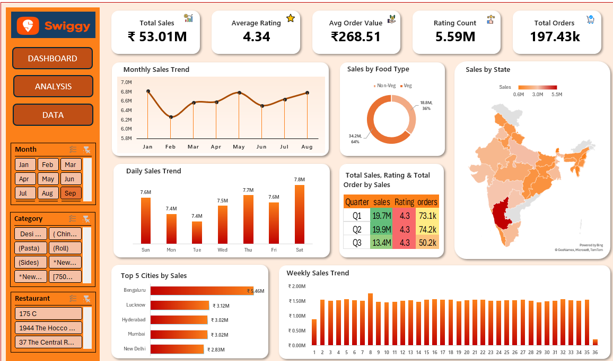

# Swiggy Sales Analysis Dashboard | Microsoft Excel

## 📌 Project Overview

The **Swiggy Sales Analysis Dashboard** is an interactive data analytics project developed using Microsoft Excel to analyze **1.97 lakh+ records** and gain insights into sales performance, customer ratings, order trends, food categories, and geographical sales distribution.

The project transforms raw data into meaningful business insights through data cleaning, analysis, and interactive visualizations. The dashboard helps identify top-performing cities, analyze food-type sales, track sales trends, and understand customer ordering patterns.

## 🎯 Project Objectives

- Analyze overall sales performance and order trends.
- Evaluate average customer ratings and rating distribution.
- Compare sales performance across food types and categories.
- Identify top-performing cities and states.
- Monitor monthly, daily, and weekly sales trends.
- Build an interactive dashboard to support data-driven decision-making.

## 🛠️ Tools & Technologies

- **Microsoft Excel**
- Data Cleaning and Data Transformation
- Pivot Tables and Pivot Charts
- Excel Formulas and Functions
- Slicers and Interactive Filters
- Dashboard Design and Data Visualization

## 📊 Key Performance Indicators (KPIs)

The dashboard provides the following key metrics:

- **Total Sales:** ₹53.01M
- **Average Rating:** 4.34
- **Average Order Value:** ₹268.51
- **Rating Count:** 5.59M
- **Total Orders:** 197.43K

*These figures represent the metrics displayed in the dashboard.*

## 📈 Dashboard Features

### 1. Monthly Sales Trend
Visualizes monthly sales performance from January to August to identify growth patterns and fluctuations.

### 2. Daily Sales Trend
Compares sales across the days of the week to understand daily sales variations and identify high-performing days.

### 3. Weekly Sales Trend
Displays sales performance across the reporting period to track weekly patterns and changes in sales volume.

### 4. Sales by Food Type
Compares vegetarian and non-vegetarian sales using a doughnut chart to understand the contribution of each food type.

### 5. Sales by State
Uses a geographical map to visualize sales distribution across states and identify important regional markets.

### 6. Top 5 Cities by Sales
Highlights the top five cities based on sales performance, helping identify key revenue-generating locations.

### 7. Sales, Ratings & Orders Analysis
Presents a quarterly comparison of sales, customer ratings, and order counts to evaluate business performance across quarters.

### 8. Interactive Slicers
Includes filters for:
- Month
- Food Category
- Restaurant

These slicers allow users to explore the dashboard dynamically and analyze specific segments of the data.

## 🔍 Data Analysis Process

1. **Data Collection:** Loaded the Swiggy dataset containing more than 1.97 lakh records.
2. **Data Cleaning:** Checked data quality, handled missing or inconsistent values where required, and prepared the dataset for analysis.
3. **Data Transformation:** Organized the data into a suitable structure for calculations and reporting.
4. **Data Analysis:** Used Excel formulas, Pivot Tables, and aggregations to calculate KPIs and identify sales patterns.
5. **Data Visualization:** Created charts, geographical maps, KPI cards, and interactive slicers.
6. **Dashboard Development:** Combined the visualizations into a single dashboard for business performance monitoring.

## 💡 Key Insights

The dashboard enables users to:
- Monitor overall sales and order performance.
- Compare monthly, daily, and weekly sales trends.
- Understand the contribution of vegetarian and non-vegetarian food sales.
- Identify top-performing cities and regional sales patterns.
- Track customer ratings alongside sales and order volumes.
- Filter data by month, category, and restaurant for more focused analysis.

## 📷 Dashboard Preview



## 📂 Project Structure

```text
Swiggy-Sales-Analysis/
│
├── Dashboard.xlsx
├── DASHBOARD.png
└── README.md
```

*Update the filenames above to match the actual files uploaded to your GitHub repository.*

## 🚀 Skills Demonstrated

- Data Cleaning and Data Preparation
- Exploratory Data Analysis (EDA)
- Microsoft Excel
- Pivot Tables and Pivot Charts
- Excel Formulas and Functions
- KPI Development
- Interactive Dashboard Creation
- Business Intelligence and Data Visualization
- Sales Performance Analysis

## 👨‍💻 Conclusion

This project demonstrates how Microsoft Excel can be used to analyze a large dataset of **1.97 lakh+ records** and convert raw data into an interactive sales dashboard. It showcases practical data analytics skills, including data preparation, KPI analysis, visualization, and business insight generation.

The project strengthened my ability to use Excel for real-world business analysis and present findings through a clear, interactive dashboard.

---
**Project:** Swiggy Sales Analysis Dashboard  
**Tool:** Microsoft Excel  
**Domain:** Sales Analytics | Food Delivery
